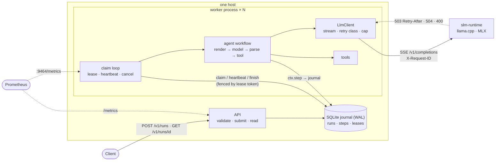

# SOF: durable agents for small language models

SOF runs tool-using agents on 0.5–3B models as **durable workflows**: every model call and tool
call is journaled to SQLite, so a crashed worker's runs resume elsewhere without paying for
finished model calls again. There is no orchestration server to run: it's a Python package plus
a SQLite file.

[](https://github.com/ragnarlothbrok53/sof/actions/workflows/ci.yml)

SOF is the orchestration layer above [**slm-runtime**](https://github.com/ragnarlothbrok53/slm-inference-engine),
a small inference server for local models. slm-runtime decides *whether* a request runs now
(admission control, deadlines, `503 + Retry-After`) and explicitly leaves retry policy to the
caller. SOF is that caller.

## Why this exists

A 0.5B model on a CPU takes seconds per call and is unreliable in ways that compound over a
multi-step task:

- **It's wrong in the format, not just the content.** It emits JSON wrapped in prose, Python
  dicts instead of JSON, or repeats the same tool call forever.
- **Its server pushes back.** A busy inference server answers `503`; a model reload takes it
  away for a minute.
- **Agent runs are long and expensive to restart.** A crash at step 5 of 6 shouldn't cost five
  model calls again.

The usual answer to the last point is a workflow engine like Temporal, which is a cluster to run
before your first agent works. SOF implements the part an agent loop needs (journaled steps,
leases, fenced recovery, classified retries) in about 800 lines, and backs each guarantee with a
test that breaks it on purpose and a measurement.

## Key features

- **Durable execution.** `await ctx.step(name, fn, arg)` journals each result. After a crash,
  finished steps return their recorded result (~0.03 ms) instead of running again. Leases with
  fencing tokens let a crashed or stalled worker's runs move to another worker, safely. Tested by
  killing a real worker process mid-call.
- **Failure-aware LLM client** for slm-runtime and other OpenAI-compatible `/v1/completions`
  servers. It maps `503`/`429`/`504`/`5xx`/`4xx`, in-band stream errors and truncated streams to
  retry decisions, with jittered backoff that never undercuts `Retry-After`. A client-side
  concurrency cap matches server capacity. It always streams, so cancelling a run stops
  generation on the server.
- **An agent loop built for small models.** Bounded steps and repairs; a lenient parser that
  never raises on model output; a repeat-call guard; a forced answer when the model loops; two
  prompt protocols (generic JSON with prefill, and Qwen2.5's native tool-call format).
- **Typed tools.** A function plus a pydantic argument model. Bad arguments and tool errors go back
  to the model; unexpected exceptions are retried. Comes with a safe AST calculator and
  `idempotency_key()` for tools with side effects.
- **HTTP API and CLI:**
  - submit (idempotent `run_id`, optional `?wait=true`), inspect with live step progress, cancel;
  - `sof serve` runs the API and a worker in one process, `sof worker` scales out on one host;
  - `sof run "question"` runs a single task in the current process.
- **Observability.** Prometheus metrics that separate live work from replayed steps, structured
  logs, and `X-Request-ID = run.step.attempt` propagated into slm-runtime's logs.
- **Evidence.**
  - 124 tests: unit, engine semantics, API, contract tests against the real slm-runtime v0.1.0,
    and a process-kill recovery test. They were checked by mutation (9 deliberately broken
    guarantees, all caught).
  - Benchmarks with committed raw results.

## Architecture



- **Request path.** The API validates a run and inserts it as `pending`; it never executes
  anything. A worker claims the oldest claimable run inside a `BEGIN IMMEDIATE` transaction (so
  two workers can't both claim it), sets a lease and bumps the lease token. It then runs the
  workflow. Each `ctx.step` either returns a journaled result or executes, retrying as its policy
  says, and writes the outcome, fenced by the token, before returning.
- **Interfaces.**
  - A workflow is `async def wf(ctx, input) -> output`. A step function is
    `async def f(arg) -> T` with dataclass or plain types, since results are journaled as JSON.
  - A tool is `@tool def f(args: SomeModel) -> str`.
  - The LLM boundary is an OpenAI-style `/v1/completions` stream.
- **Failure boundaries.**
  - Bad model output, tool failure: the error goes back to the model.
  - Overload or LLM outage: the step retries, then the run fails.
  - Worker crash: other workers take over that worker's runs.
  - A run that keeps killing workers: the run fails after N claims.
  - Changed workflow code: the run fails loudly.
  - Host loss takes everything down: SOF is single-host by design.
- **State.** Two tables, `runs` and `steps`. Nothing else is persisted.
- **External dependencies.** An LLM server. That's all.

The sequence diagrams (a run, crash recovery), the thread model and the full failure table are in
[docs/architecture.md](docs/architecture.md).

## Technical design

| Decision | Why |
|---|---|
| Own durable engine, not Temporal / DBOS | The guarantees an agent loop needs fit in a journal and leases; no server to run. The concepts map 1:1 if you outgrow it. |
| SQLite (WAL), not Postgres / DuckDB | Multi-process OLTP on one host, in the standard library. DuckDB allows one writing process only. Postgres is the 10x path. |
| Replay by re-execution | The agent stays plain Python. The price is determinism between steps, which is enforced (`NonDeterminismError`). |
| Leases + fencing tokens | A stalled ("zombie") worker can't overwrite the run that a new owner is executing. |
| At-least-once steps | Exactly-once across systems is impossible; tools get an idempotency key instead. |
| Failures are journaled too | Replay takes the same branch the workflow already took. |
| Jittered backoff, `Retry-After` as floor | Measured: without jitter, synchronized retries left an overloaded server idle (4–7× slower batch). |
| Client concurrency cap ≤ server capacity | Measured: oversubscribing costs about 2× makespan, even with good retries. |
| Streaming client | Cancellation reaches the model; client-side TTFT is visible. |
| Two prompt protocols | Which format a 0.5B model follows best is an empirical question, so it's measured. |

Each is argued with alternatives and limits in
[docs/design-decisions.md](docs/design-decisions.md).

## Performance / Evaluation

Everything below was **measured** with the scripts in [`benchmarks/`](benchmarks/), at the commit
recorded in each `summary.json`. Host: a Windows 11 laptop (Intel Core Ultra 7 165U, 14 logical
CPUs, 32 GB, CPU only) running normal background software. Methodology and caveats are in
[docs/benchmarking.md](docs/benchmarking.md).

<!-- RESULTS -->

## Failure handling

| Situation | What happens | Mechanism |
|---|---|---|
| Model output unparseable | repair prompt with the reason; after `max_repairs`, the run completes as `max_repairs` | `parsing.py` (never raises), `agent.py` |
| Model repeats a tool call | not executed; next turn is forced to answer | repeat guard + answer prefill |
| Tool gets bad args / raises `ToolError` | the error text is the tool result the model sees | `Tool.invoke` |
| Tool raises anything else | retried (3×), then shown to the model | step retry policy |
| LLM `503` / `429` | retry after ≥ `Retry-After` + jitter | `LlmClient` → `RetryableError(retry_after)` |
| LLM `504` / `5xx` / connection error / truncated stream | retry with jittered exponential backoff; 8 attempts ≈ 45–90 s of outage | `RetryPolicy` |
| LLM `4xx` (e.g. `max_tokens` over the server limit) | run fails at once with the server's message | `PermanentError` |
| Model still loading | workers don't claim runs until `/readyz` is 200; runs wait as `pending` | `wait_for_llm` |
| Worker killed | its runs resume on another worker after the lease (default 15 s) | lease expiry + journal replay |
| Worker stalled past its lease | its writes are rejected; it abandons the run | fencing token |
| Run crashes every worker | failed after `SOF_MAX_RUN_ATTEMPTS` (5) claims | `attempts` counter |
| `SIGTERM` | stop claiming; in-flight runs get `SOF_SHUTDOWN_GRACE_S`, then are handed back (not failed) | `Worker._drain` + `Store.release` |
| Cancel | pending: immediate. Running: within `lease_s/3`; the HTTP stream closes, so slm-runtime stops generating | heartbeat reads the cancel flag |
| Duplicate submit | same `run_id` + same input returns the same run; different input returns `409` | `Store.submit` |
| Embedded worker dies (`sof serve`) | logged; `/readyz` turns `503` | done-callback |

## Observability

**Metrics** (Prometheus; worker on `:9464`, API on `/metrics`):

| Metric | Answers |
|---|---|
| `sof_runs{status}` | How many runs are pending / running / done? (sampled from the journal) |
| `sof_runs_active`, `sof_run_claims_total{kind=new\|resumed}` | Is this worker busy? How often are runs recovered from another worker? |
| `sof_runs_finished_total{outcome}`, `sof_run_duration_seconds` | Outcomes; submit-to-done latency including queueing and recovery |
| `sof_steps_total{step,outcome}`, `sof_step_duration_seconds{step}` | Which step is slow or failing? (live executions only) |
| `sof_step_retries_total{step,error}` | Where are retries going, and why? |
| `sof_steps_replayed_total{step}` | Recovery at work: steps answered from the journal |
| `sof_leases_lost_total` | Workers stalling past their lease |
| `sof_llm_ttft_seconds`, `sof_llm_tokens_total{kind}`, `sof_llm_errors_total{cause}` | Model latency as SOF sees it; overload vs timeouts vs bad requests |
| `sof_agent_runs_total{status}`, `sof_agent_invalid_outputs_total`, `sof_tool_calls_total{tool,ok}` | Is the model following the protocol? Are tools succeeding? |

Replayed steps never touch the latency, token or error metrics, so a recovery doesn't look like
a burst of very fast model calls.

**Logs.** Structured, in the same format as slm-runtime (`SOF_LOG_JSON=true` for JSON lines).
Run-scoped lines carry `run_id`.

**Correlation.** Every model call carries `X-Request-ID: <run_id>.<step>.<attempt>`. It's stored
in the run's result (`steps[].llm_request_id`) and logged by slm-runtime on its access line, so
`grep <run_id>` works across both services. The test suite asserts that the two lists match.

**Live progress.** `GET /v1/runs/{id}` returns the steps journaled so far, with attempts and
durations, while the run is still going.

## Quick start

Requires Python 3.11+ and [uv](https://docs.astral.sh/uv/), plus a running slm-runtime.

```bash
# 1. The model server (separate repo)
git clone https://github.com/ragnarlothbrok53/slm-inference-engine.git
cd slm-inference-engine && uv sync --extra llama
mkdir -p models && curl -L -o models/qwen2.5-0.5b-instruct-q4_k_m.gguf \
  https://huggingface.co/Qwen/Qwen2.5-0.5B-Instruct-GGUF/resolve/main/qwen2.5-0.5b-instruct-q4_k_m.gguf
uv run slm-runtime serve                     # :8000

# 2. SOF
git clone https://github.com/ragnarlothbrok53/sof.git && cd sof
uv sync
uv run sof run "A shop sells pens at 17 rupees each. Priya buys 23 pens and pays a 4 rupee delivery fee. How much does she pay?" --protocol qwen
```

Real output from that command (Qwen2.5-0.5B, CPU). This one is correct; the model doesn't always
pick the right operator (see Performance):

```
model> <tool_call>
{{"name": "calculator", "arguments": {"expression": "17 * 23 + 4"}}
</tool_call>
tool> 395
model> Priya pays a total of 395 rupees.

answered: Priya pays a total of 395 rupees.
```

**Docker** (the whole stack; slm-runtime is built from its GitHub tag):

```bash
mkdir -p models   # put the GGUF here, as above
docker compose up --build                  # API on :8080, model server on :8000
SLM_ENGINE=fake docker compose up --build  # no model: checks the wiring only
docker compose up --scale worker=3         # more workers on the same journal
```

## Usage

```bash
uv run sof serve        # API + worker, http://127.0.0.1:8080

# Submit and wait for the result
curl -s 'localhost:8080/v1/runs?wait=true' -H 'content-type: application/json' \
  -d '{"question": "A crate holds 48 bottles. How many bottles are in 26 crates?", "protocol": "qwen"}'

# Submit without waiting (idempotent on run_id), then poll and cancel
curl -s localhost:8080/v1/runs -H 'content-type: application/json' \
  -d '{"question": "...", "run_id": "order-42"}'
curl -s localhost:8080/v1/runs/order-42          # status, answer, steps so far
curl -s -X POST localhost:8080/v1/runs/order-42/cancel
```

`POST /v1/runs` fields: `question`; `tools` (a subset of the worker's tools, null = all);
`max_steps` (1–20, default 6); `max_repairs` (0–5, default 2); `max_tokens` (per call);
`temperature`; `protocol` (`json` | `qwen`); `run_id` (an idempotency key).

**Adding tools.** Build your own worker with them:

```python
import asyncio
from pydantic import BaseModel, Field
from sof import BUILTIN_TOOLS, ToolError, idempotency_key, tool
from sof.config import Settings
from sof.worker import serve_worker

class RefundArgs(BaseModel):
    order_id: str = Field(description="e.g. A-1001")
    amount: float

@tool(description="Refund an order. Returns the refund ID.")
async def refund(args: RefundArgs) -> str:
    if args.amount <= 0:
        raise ToolError("amount must be positive")       # the model sees this and can retry
    # `payments` is your client; the key is stable across retries and crash recovery.
    return await payments.refund(args.order_id, args.amount, idempotency_key=idempotency_key())

asyncio.run(serve_worker(Settings(), tools=[*BUILTIN_TOOLS, refund]))
```

**Writing other workflows.** The engine isn't agent-specific:

```python
from sof import RunContext, Store, Worker, Workflow

async def pipeline(ctx: RunContext, doc_id: str) -> str:
    text = await ctx.step("fetch", fetch_document, doc_id)
    summary = await ctx.step("summarize", summarize, text)   # not repaid after a crash
    return await ctx.step("store", save_summary, summary)

worker = Worker(Store("sof.db"), [Workflow.define("pipeline", pipeline)])
```

## Configuration

Environment variables (prefix `SOF_`), a `.env` file (see [`.env.example`](.env.example)), or CLI
flags (`--db`, `--llm-url`, `--host`, `--port`), which take precedence. Full definitions, types
and bounds are in [`config.py`](src/sof/config.py).

| Variable | Default | Meaning |
|---|---|---|
| `SOF_DB_PATH` | `sof.db` | The SQLite journal, shared by the API and workers on this host |
| `SOF_DB_SYNCHRONOUS` | `FULL` | `FULL`: finished steps survive power loss. `NORMAL`: survive crashes only; cheaper commits |
| `SOF_LLM_BASE_URL` | `http://127.0.0.1:8000` | slm-runtime or another OpenAI-compatible server |
| `SOF_LLM_CONCURRENCY` | `1` | Model calls in flight per worker. Set to slm-runtime's `SLM_REPLICAS`; never above replicas + queue |
| `SOF_LLM_TIMEOUT_S` | `130` | Per attempt; keep it above slm-runtime's 120 s deadline |
| `SOF_LLM_MAX_ATTEMPTS` | `8` | Per model call; about 45–90 s of tolerated outage |
| `SOF_MAX_CONCURRENT_RUNS` | `8` | Runs one worker executes at once |
| `SOF_LEASE_S` | `15` | Recovery time after a crash vs heartbeat write rate |
| `SOF_MAX_RUN_ATTEMPTS` | `5` | Claims before a run is declared poison |
| `SOF_SHUTDOWN_GRACE_S` | `10` | Time in-flight runs get on SIGTERM before being handed back |
| `SOF_POLL_INTERVAL_S` | `0.2` | Idle claim polling |
| `SOF_API_HOST`, `SOF_API_PORT` | `127.0.0.1`, `8080` | API bind address |
| `SOF_METRICS_PORT` | `9464` | Worker Prometheus port (0 disables) |
| `SOF_LOG_LEVEL`, `SOF_LOG_JSON` | `INFO`, `false` | Logging |

## Testing

```bash
uv sync                      # dev deps include slm-runtime v0.1.0 for the contract tests
uv run pytest                # 124 tests, ~25 s
uv run ruff check . && uv run ruff format --check . && uv run mypy
```

What the tests pin down ([`tests/`](tests/)):

- **Engine** (`test_engine.py`, `test_store.py`):
  - finished steps aren't re-executed on resume;
  - four separate connections racing for 20 runs claim each exactly once;
  - expired leases are reclaimed, and the old owner is fenced;
  - a zombie worker stops itself;
  - retries are bounded and honour `Retry-After`; permanent errors fail fast;
  - failures replay identically; changed workflow code is detected;
  - poison runs are abandoned; cancellation stops the in-flight step;
  - graceful shutdown hands runs back; the concurrency limit holds;
  - the documented retry budget (45–90 s) holds.
- **Agent** (`test_agent.py`):
  - tool then answer; repair after invalid output; bounded repairs;
  - the repeat guard and the forced answer; the step budget;
  - tool errors are shown to the model; LLM failures (transient retried, permanent fatal);
  - both protocols;
  - a resumed run makes exactly one more model call, with a byte-identical prompt.
- **LLM client** (`test_llm.py`): SSE parsing, the status-code → retry mapping, in-band errors,
  truncated streams, total deadline, concurrency cap, readiness.
- **Contract with slm-runtime** (`test_integration.py`, the real v0.1.0 server over a socket):
  - an end-to-end agent run, with request IDs matching one-to-one between the journal and
    slm-runtime's logs;
  - a server with no queue, oversubscribed 4×: every 503 is retried, every run completes, and no
    model call runs twice;
  - cancelling a run stops generation on the server.
- **Crash** (`test_crash.py`): a worker *process* is killed during a model call, and a new
  process finishes the run. The finished model call ran once; the interrupted one ran twice, with
  an identical prompt.

**Mutation check.** Each of these deliberate bugs makes at least one test fail:
- disabling journal replay;
- removing write fencing;
- a deferred (not `IMMEDIATE`) claim transaction;
- not retrying 503;
- ignoring the cancel flag;
- ignoring `Retry-After`;
- not checking the lease on heartbeat;
- removing the repeat guard;
- a non-streaming client.

CI ([`.github/workflows/ci.yml`](.github/workflows/ci.yml)) runs lint, format, strict mypy and all
tests, and brings up the compose stack (slm-runtime with the fake engine) to push a run through
API → journal → worker → slm-runtime and back.

## Benchmarking

```bash
uv run python benchmarks/bench_engine.py      # journal overhead, FULL vs NORMAL  (~1 min, no model)
uv run python benchmarks/bench_recovery.py    # kill workers, measure recovery   (~3 min, no model)
uv run python benchmarks/bench_overload.py    # vs a real slm-runtime, fake engine (~4 min)
uv run python benchmarks/eval_agent.py --llm-url http://127.0.0.1:8000   # real model (~40 min on CPU)
```

Each writes `benchmarks/results/<name>/summary.json` (environment, commit, config, summary) and
`rows.csv` (raw rows). Details and caveats are in [docs/benchmarking.md](docs/benchmarking.md).

## Design tradeoffs

**Why not Temporal?** The previous version of this repo used it. Temporal is the right tool for
multi-host workers, long timers, signals, versioned workflows and an ops UI. SOF needs none of
these for its target use case, a few workers next to a local model, and each of them would add a
cluster to run first. If you need them, the concepts map directly: steps are activities, the
journal is the event history, the lease is the heartbeat timeout.

**Why SQLite?** Several processes making small transactional writes on one host is exactly what
SQLite in WAL mode does well, and it ships with Python. DuckDB was considered and rejected: one
writing process per file. Postgres is the scale-out path (see below).

**Where it breaks down:**
- **One host.** SQLite's locking doesn't hold on network filesystems, so all workers must share a
  disk (or a VM under Docker Desktop).
- **One writer.** With `FULL`, a journal sustains a few hundred step commits per second. That's
  irrelevant at CPU model speeds (one call per second or more), but a ceiling for fast GPU
  backends with many workers.
- **Recovery waits for the lease.** That's 15 s by default: a shorter lease recovers faster and
  costs more heartbeat writes.
- **No workflow versioning.** Changing the agent's step sequence fails in-flight runs (loudly).
  Drain workers before deploying such changes.
- **No retention.** The journal grows; there's no pruning yet.
- **The model is the weak link.** The orchestration can make a 0.5B model use a tool and stop
  looping. It can't make it write the right expression: the remaining errors in the eval are
  mostly wrong formulas, faithfully computed.

**Current limitations:**
- ChatML models only, via raw completions (the chat template is applied client-side).
- No constrained decoding (slm-runtime has no grammar support).
- No auth or multi-tenancy on the API.
- `?wait=true` and idle workers poll the journal.
- The MLX backend path is untested here, as in slm-runtime.

**At 10x scale I would change:**
1. **Storage.** Move `store.py` to Postgres: `FOR UPDATE SKIP LOCKED` claims, the same fencing
   token, and `LISTEN/NOTIFY` instead of polling. That allows workers on several hosts. The
   engine, agent and API don't change.
2. **Backpressure.** Use a global LLM concurrency budget (a token bucket in the database, or a
   gateway) instead of a per-worker cap, since workers × cap must stay within the servers'
   replicas + queue. Route model calls by queue depth (`slm_queue_depth`) across several
   slm-runtime instances.
3. **Output constraints.** Use constrained decoding (a GBNF grammar from the tool schemas) in
   slm-runtime instead of prefill-and-repair. It removes invalid output by construction.
4. **Deploys.** Add workflow versioning (a version on each run, old code kept until the run
   drains) and retention for finished runs.
5. **Tracing.** Use OpenTelemetry once tools call other services; the step request ID is where the
   trace context would go.

## Roadmap

- `grammar` / `response_format` support in slm-runtime, and a constrained-decoding protocol here
- Postgres store behind the same interface
- `sof prune --older-than` (journal retention)
- A version field on runs, for safe deploys of changed workflows
- Evaluation beyond arithmetic word problems (multi-tool tasks), and on 1.5B / 3B models

## Project structure

```
src/sof/      engine.py · store.py · agent.py · prompts.py · parsing.py · llm.py · tools.py
              api.py · worker.py · cli.py · config.py · contracts.py · metrics.py · logs.py
tests/        engine, store, agent, API, LLM client, slm-runtime contract, process-kill recovery
benchmarks/   bench_engine · bench_recovery · bench_overload · eval_agent · data/ · results/
docs/         architecture.md · design-decisions.md · benchmarking.md
```

## License

MIT, see [LICENSE](LICENSE).
