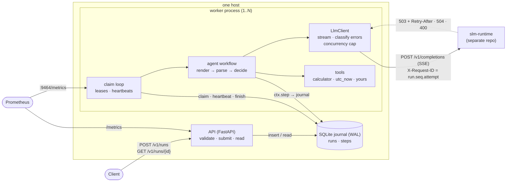
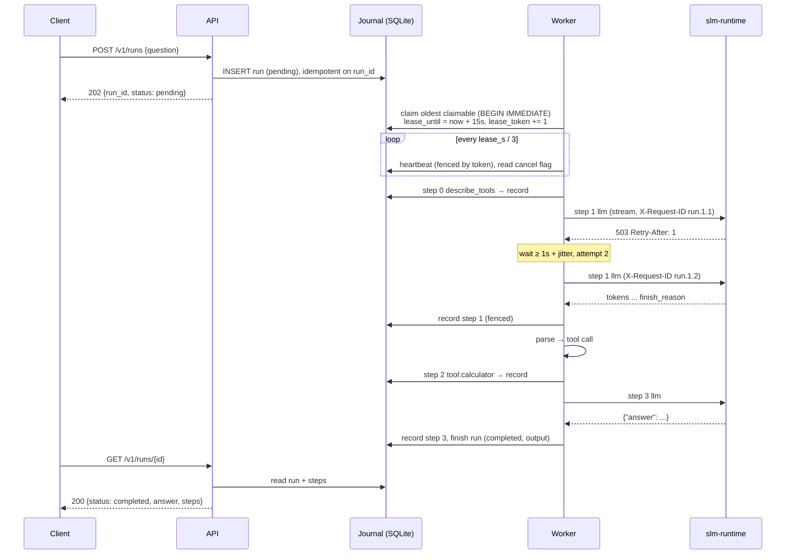
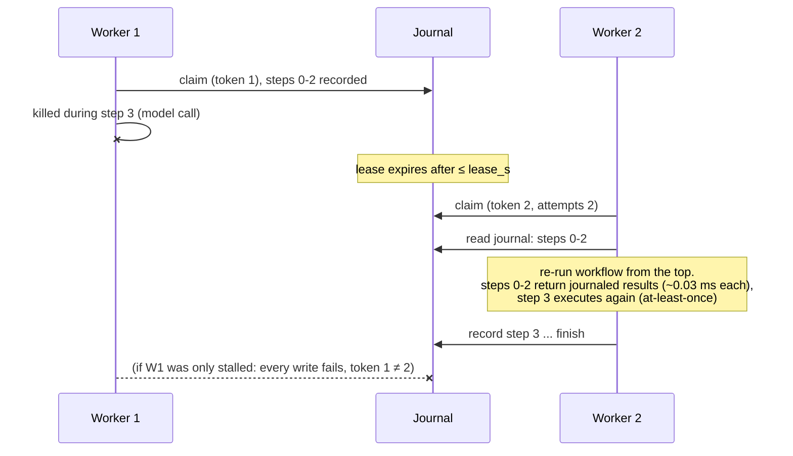

# Architecture

## Components



| Component | Module | Responsibility |
|---|---|---|
| API | `api.py` | Validates requests, writes runs, reads runs and steps back. Never executes anything. |
| Journal | `store.py` | All SQL. Runs, leases, fencing, step records. One thread per process owns the connection. |
| Engine | `engine.py` | `Worker` (claim loop, heartbeats, cancellation, shutdown) and `RunContext.step` (journal lookup, retries, recording). |
| Agent | `agent.py` | The workflow: a bounded loop of model call, parse, tool call; repair, repeat guard, forced answer. |
| Protocols | `prompts.py`, `parsing.py` | ChatML rendering and reply parsing for the `json` and `qwen` formats. Pure functions. |
| LLM client | `llm.py` | Streaming `/v1/completions`, maps status codes to retry decisions, caps concurrency. |
| Tools | `tools.py` | Typed tool registry, safe calculator, idempotency keys. |
| Wiring | `worker.py`, `cli.py` | Builds a worker from settings; `sof serve / api / worker / run`. |

**Execution paths.**
- `sof serve`: the API and one worker in a single process. The simplest deployment.
- `sof api` + `sof worker`: separate processes, as many workers as you like on one host, all
  sharing the journal.
- `sof run "..."`: a one-shot run in the current process.

The journal is the only thing these paths share, so they behave identically.

## A run, step by step



## Crash recovery



## Concurrency model

- **Worker process.** One asyncio event loop runs the claim loop and up to
  `SOF_MAX_CONCURRENT_RUNS` run tasks. Each run task has a sibling heartbeat task. Model calls are
  async HTTP, and sync tools run in `asyncio.to_thread`, so nothing blocks the loop.
- **Journal access.** Each `Store` owns one SQLite connection on one dedicated thread; every call
  is a short transaction executed there. Across processes, SQLite's file lock serializes writers.
  `BEGIN IMMEDIATE` takes the write lock before reading, so two workers can't both see a run as
  claimable.
- **LLM concurrency.** A semaphore in `LlmClient` caps in-flight calls per worker. With several
  workers, the total is workers × cap, and that's what has to fit within the server's
  `replicas + queue`.

## State

All durable state is in two tables:

```
runs   id · workflow · input (JSON) · status · output · error · attempts
       lease_owner · lease_until · lease_token · cancel_requested · created_at · updated_at
steps  (run_id, seq) · name · ok · output (JSON) | error (JSON) · attempts · started_at · finished_at
```

`status` is one of `pending`, `running`, `completed`, `failed` or `cancelled`. A `running` run
whose lease has expired can be claimed. Inputs and outputs are the dataclasses in `contracts.py`,
serialized with pydantic. Changing their fields is a compatibility decision for in-flight runs.

Nothing else is persisted. Metrics and logs are per process; the model server is stateless from
SOF's point of view.

## Failure boundaries

| Failure | Contained to | Outcome |
|---|---|---|
| Invalid request | the request | `400 invalid_request_error`; nothing written |
| Same `run_id`, different input | the request | `409 conflict` |
| Model replies with unusable output | the run | repair prompt; after `max_repairs`, the run completes with `status: max_repairs` |
| Tool raises / bad tool arguments | the step | the error becomes the tool's result; the model sees it |
| LLM server overloaded (503) / restarting | the step | jittered retries for 45–90 s, then the run fails |
| LLM rejects the request (4xx) | the run | fails at once; the error is in the run |
| Worker crash / kill | that worker's runs | resumed by another worker after the lease expires |
| Worker stalls past its lease (zombie) | that worker | its writes are fenced and it abandons the run |
| A run that crashes every worker | the run | failed after `SOF_MAX_RUN_ATTEMPTS` claims |
| Workflow code changed under an in-flight run | the run | `NonDeterminismError`; the run fails |
| Journal unavailable | the process | API `/readyz` 503; workers' heartbeats fail and leases lapse |
| Host failure | everything | journal on local disk: SOF is single-host by design |

## External dependencies

- An OpenAI-compatible `/v1/completions` server. It's built and tested against slm-runtime v0.1.0,
  whose admission control, deadlines, cancellation and `/readyz` SOF relies on. Other servers
  (`llama-server`, vLLM) speak the same API; the retry mapping is the same, and SOF treats a
  missing `/readyz` (404) as ready.
- Local disk for the SQLite file.

## Observability

- **Metrics.** Prometheus: the worker on `SOF_METRICS_PORT`, the API on `/metrics` (with `sof serve`,
  both in one registry). The catalogue is in the README.
- **Logs.** Structured (`SOF_LOG_JSON=true` for one JSON object per line), with the same format as
  slm-runtime. Run-scoped lines carry `run_id`; API access lines carry `request_id`.
- **Correlation.** Each model call's `X-Request-ID` is `run_id.seq.attempt`. It's stored in the
  agent's result (`steps[].llm_request_id`) and logged by slm-runtime, so a slow or failed call in
  a run can be found in the server's logs directly.
- **Live progress.** `GET /v1/runs/{id}` lists the steps journaled so far, with attempts and
  durations. That works mid-run because it reads the same table the workers write.
